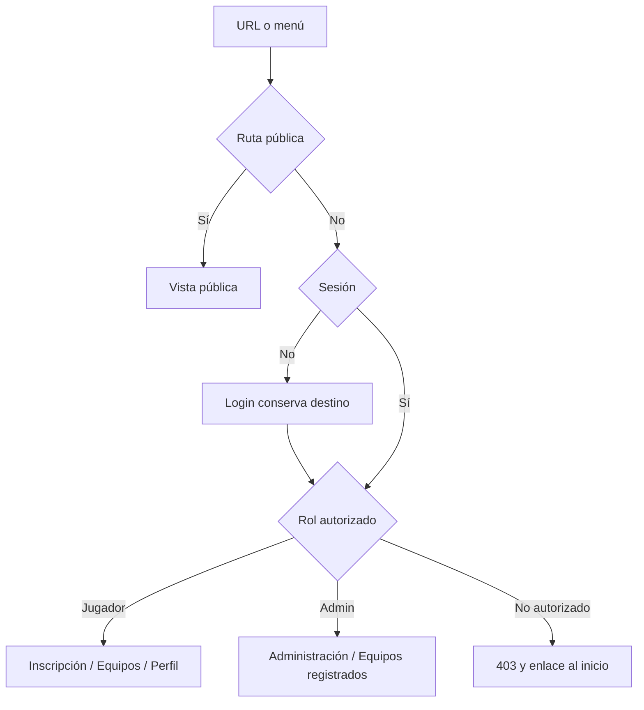
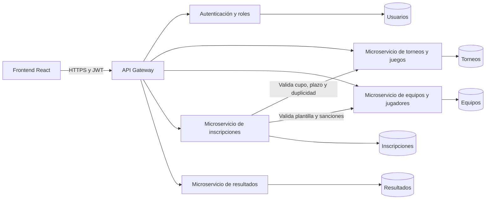

# ERS v2 — eSports Arena Manager

Evaluación Parcial 2 · DSY1104 Desarrollo FullStack II · Duoc UC
Equipo: Ángel Quintero, Luis Ahumada y Cristian Villavicencio
Versión: 2.0 · 16 de octubre de 2026

## 1. Introducción

Este documento especifica el frontend React de gestión de torneos eSports. La solución migra las seis vistas de EP1 y agrega autenticación simulada por roles, gestión administrativa y operaciones CRUD conectadas a la interfaz.

Usuarios: visitante, jugador y administrador. Los datos son ficticios y se mantienen en el navegador. Esta entrega no presta un servicio real de inscripción ni protege información mediante un servidor.

## 2. Propuesta de solución y herramientas

| Herramienta | Uso |
|---|---|
| VS Code u otro editor | Edición del proyecto por el equipo |
| Git / GitHub | Historial colaborativo e integración mediante PR; base de EP2 en develop |
| Node y npm | Instalación reproducible con package-lock.json |
| Vite | Desarrollo y compilación |
| React / React DOM | Componentes funcionales, props, estado y efectos |
| React Router | Rutas por URL, enlaces activos y protección |
| Bootstrap 5 | Grilla, navbar, cards, controles y tablas responsivas |
| oxlint | Revisión estática con configuración conservada |
| Jasmine / Karma / Chrome | Pruebas unitarias y de componentes en navegador |
| esbuild / Istanbul | Transformación JSX e instrumentación |
| Playwright | Recorridos completos y evidencias responsivas |

Las versiones exactas están fijadas por package-lock.json. La verificación de la corrección de TablaRanking empleó Node 24.22.0 y Edge 155 mediante el launcher ChromeHeadless de Karma. Las pruebas y resultados se detallan en COBERTURA_TESTING.md; los recorridos y capturas de Playwright corresponden a la ejecución anterior.

### Carpetas

- src/components/inicio, torneos, inscripcion, equipos, perfil: las seis vistas del caso.
- src/components/auth, admin: sesión, permisos y administración.
- src/components/layout, compartidos: armazón y piezas reutilizables.
- src/logica: funciones de negocio puras y sus specs adyacentes.
- src/datos: semilla, CRUD y hook de carga/suscripción.
- src/styles/utilidades.css: clases compartidas.
- src/index.css: variables y base visual.
- src/pruebas: fixtures y helpers DOM; tests/e2e: recorridos.
- docs: especificación, decisiones, defensa, pruebas y capturas.

## 3. Paleta y accesibilidad

| Token | Color | Uso |
|---|---|---|
| fondo | #0E0B16 | Fondo general |
| superficie | #1C1430 | Tarjetas y paneles |
| primario | #9146FF | Identidad Arena púrpura |
| acción | #7030CC | Botón primario con texto claro |
| acento | #00F5D4 | Enlaces, foco y estado habilitado |
| texto | #F1ECFF | Contenido principal |
| secundario | #C7BBDC | Ayuda y contenido secundario |
| error | #FF5C7A | Mensajes y bordes de error |
| borde | #8C7AAB | Delimitación de controles y paneles |

Los colores se declaran únicamente en :root del CSS propio y sobrescriben variables de Bootstrap. El texto primario de los botones mide al menos 16 px. Se usan labels asociados, errores con role=alert y aria-describedby, foco visible, enlace para saltar al contenido, alt de imágenes, título del iframe, badges con texto, tablas con caption y encabezados con scope. Cada vista posee un h1.

## 4. Datos y persistencia

| Entidad | Campos centrales y relaciones |
|---|---|
| Juego | id, nombre, modalidad, jugadoresPorEquipo, imagen |
| Torneo | id, juegoId, nombre, estado, cupoMax, inscritos[], cierreISO, fechaInicio, premios[], partidas[], ranking[] |
| Equipo | id, juegoId, capitanId, integrantes[], suplentes, estado, sanciones[], torneosIds[] |
| Jugador | id, nombre, apodo, correo, equipos[], historial[], victorias, derrotas, sanciones[], avatar |
| Inscripción | id, torneoId, participanteId, tipoParticipante, jugadorId, correo |
| Resultado | id, torneoId, partidaId, localId, visitanteId, puntajeLocal, puntajeVisitante, estado |
| Usuario ficticio | id, nombre, correo, clave de demostración, rol, jugadorId |

Una inscripción se vincula a jugador o equipo según modalidad. Crear/cancelar actualiza relaciones y cupos juntos. Los lectores devuelven copias, y los suscriptores reciben un estado nuevo después de una escritura exitosa.

localStorage guarda arena-ep2-datos-v1; sessionStorage guarda arena-ep2-sesion-v1 sin contraseña. La persistencia es local a este navegador, no una base multiusuario.

## 5. Requisitos funcionales

| ID | Requisito y aceptación |
|---|---|
| RF01 | Inicio muestra hero, torneos destacados, próximo cierre, video e información institucional. |
| RF02 | Catálogo filtra en vivo por nombre, juego, estado y rango de cierre. Un rango invertido informa error; cero coincidencias muestra vacío. |
| RF03 | Detalle por id muestra datos, inscritos, premios, ranking y partidas. Id inexistente redirige al catálogo. |
| RF04 | DetalleTorneo prepara el ranking por puntos descendentes y luego diferencia de puntaje, sin mutar el original. TablaRanking renderiza una fila por participante respetando exactamente el orden recibido. |
| RF05 | Partidas muestran ronda, horario y estado textual. La ronda visible es local; rival ausente indica “Participante por definir”. |
| RF06 | Inscripción exige correo y modalidad compatible; nunca permite cupos negativos ni inscripciones cuando se supera el cierre. |
| RF07 | Se bloquea duplicidad por torneo y participante, incluso si se intenta directamente desde el servicio. |
| RF08 | Solo el capitán inscribe un equipo completo y habilitado; equipos inactivos, incompletos o sancionados se bloquean. |
| RF09 | Una sanción vigente y dentro de sus fechas bloquea; una cumplida no bloquea. Se revisan jugador, equipo e integrantes. |
| RF10 | El formulario confirma participante, torneo y contacto sin afirmar que se envió un correo. El perfil permite editar contacto/cancelar antes del cierre. |
| RF11 | CRUD de equipos propios con nombre único, capitán titular, integrantes no repetidos, plantilla exacta, suplentes enteros 0–2, clave mínima de seis y confirmación coincidente. |
| RF12 | Perfil presenta estadísticas, equipos, historial y sanciones; permite apodo de 3–15 caracteres sin espacios y avatar de tipo/tamaño admitido. |
| RF13 | Login ficticio distingue errores de formato y credenciales, restaura sesión al recargar y permite cerrarla. |
| RF14 | Menú y URL aplican roles. Visitante va a login conservando destino; un rol incompatible ve 403. |
| RF15 | Admin realiza CRUD de juegos y torneos; exige cupo entero positivo e inicio posterior al cierre. |
| RF16 | Reglas críticas de torneos iniciados y relaciones referenciadas no se destruyen mediante edición/eliminación. |
| RF17 | Admin consulta equipos, integrantes con nombre/apodo/correo/rol, sanciones, torneos enlazados, resultados, posición y premios finales; dispone de búsqueda y estado vacío. |
| RF18 | Los cambios actualizan React y persisten al recargar; fallos del almacenamiento se informan sin publicar cambios parciales. |

## 6. Requisitos no funcionales

| ID | Requisito verificable |
|---|---|
| RNF01 | Componentes funcionales por área, lógica pura separada y estado inmutable. |
| RNF02 | Bootstrap y CSS propio sin !important ni hex fuera de :root. La única excepción inline es el ancho calculado de BarraCupos, justificado con un comentario técnico. |
| RNF03 | Vistas verificadas a 360, 768 y 1280 px, sin desbordamiento horizontal de la página; tablas pueden desplazarse internamente. |
| RNF04 | Accesibilidad descrita en sección 3, estados no dependientes solo de color. |
| RNF05 | Vite produce build y oxlint termina sin errores. |
| RNF06 | Jasmine/Karma cubre los diez casos obligatorios, fronteras, props, eventos, estado e inmutabilidad; se publica cobertura real por archivo. |
| RNF07 | Solo cuentas ficticias. No se guardan claves en sesión o equipos. En EP3 el servidor revalidará toda autorización. |
| RNF08 | Instalación reproducible con npm ci; instrucciones, decisiones, capturas y ZIP sin dependencias ni historial privado. |

## 7. Rutas y navegación por rol

| Ruta | Visitante | Jugador | Admin |
|---|---|---|---|
| /, /torneos, /torneos/:id | Sí | Sí | Sí |
| /login | Sí | Redirige | Redirige |
| /inscripcion, /equipos, /perfil | Login | Sí | 403 |
| /admin, /admin/equipos | Login | 403 | Sí |



La recarga funciona con fallback SPA. No se permite a admin ocupar las pantallas de jugador.

## 8. Componentes, props y estado

```text
main: BrowserRouter
└─ AuthProvider [estado: sesión, error; efecto: storage con limpieza]
   └─ App [useDatos: datos, carga, error; suscripción con limpieza]
      └─ Layout [efecto: título y scroll]
         ├─ Cabecera
         ├─ Navegacion [estado: expandida; contexto: rol y cerrarSesion]
         ├─ Routes
         │  ├─ Inicio(datos) → Hero + TorneosDestacados(torneos,juegos)
         │  │  └─ TarjetaTorneo(torneo,juego)
         │  ├─ CatalogoTorneos(datos) [estado: filtros]
         │  │  └─ FiltrosTorneos(filtros,juegos,errores,onCambiar)
         │  ├─ DetalleTorneo(datos) [params: id; estado: rondaElegida]
         │  │  ├─ TablaRanking(ranking)
         │  │  └─ ListaPartidas(partidas,datos) → LlaveTorneo(local,visitante)
         │  ├─ Login [estado: campos y errores; contexto: iniciarSesion]
         │  └─ RutaProtegida
         │     ├─ Inscripcion(datos) [URL: torneo]
         │     │  ├─ ResumenTorneo(torneo,juego)
         │     │  └─ FormularioInscripcion(...,onEnviar) [campos/errores/confirmación]
         │     ├─ GestionEquipos(datos) [id de edición y confirmación]
         │     │  └─ FormEquipo(...,onGuardar,onCancelar) → ListaIntegrantes(...,onQuitar)
         │     ├─ PerfilJugador(datos) → AvatarJugador + Estadisticas + MisInscripciones
         │     ├─ PanelAdmin(datos) → FormTorneo + FormJuego
         │     └─ EquiposRegistrados(datos) [estado: búsqueda]
         └─ PieDePagina
```

Campo, Boton, BadgeEstado y MensajeError son compartidos. Los resultados filtrados, cupos, ranking, permisos y pertenencias se derivan de los datos, sin duplicar estado. Los formularios conservan borradores locales; sus callbacks delegan las escrituras al padre/servicio. useDatos levanta el estado compartido en App.

## 9. Trazabilidad

| RF / RNF | Implementación | Evidencia de prueba |
|---|---|---|
| RF01, RNF03 | Inicio, Hero, TorneosDestacados | Playwright “vistas y navegación responsivas” |
| RF02 | CatalogoTorneos, filtros, filtrarTorneos | torneos.spec.js; App.spec.js |
| RF03, RF05 | DetalleTorneo, ListaPartidas, LlaveTorneo | DetalleTorneo.spec.js; LlaveTorneo.spec.js |
| RF04 | ranking.js, DetalleTorneo, TablaRanking | ranking.spec.js; DetalleTorneo.spec.js; TablaRanking.spec.js |
| RF06–09 | inscripcion.js, equipos.js, FormularioInscripcion | inscripcion.spec.js; equipos.spec.js; FormularioInscripcion.spec.js |
| RF10, RF18 | datos.js, Inscripcion, MisInscripciones | datos.spec.js; Playwright inscripción |
| RF11 | FormEquipo, ListaIntegrantes, GestionEquipos | equipos.spec.js; datos.spec.js; Playwright CRUD equipo |
| RF12 | PerfilJugador, AvatarJugador | perfil.spec.js; App.spec.js; Playwright perfil |
| RF13–14 | acceso, sesion, AuthProvider, RutaProtegida | acceso.spec.js; sesion.spec.js; RutaProtegida.spec.js; App.spec.js; Playwright permisos |
| RF15–16 | PanelAdmin, FormTorneo, FormJuego, datos | juegos.spec.js; torneos.spec.js; datos.spec.js; Playwright CRUD admin |
| RF17 | EquiposRegistrados | App.spec.js; capturas administrativas |
| RNF01, RNF05 | src y configuración | lint, build y pruebas de inmutabilidad |
| RNF02, RNF04 | index.css, Campo, layouts | revisión estática, contraste y capturas |
| RNF06 | karma.conf.cjs, specs | COBERTURA_TESTING.md; salida-pruebas.txt |
| RNF07–08 | sesiones, documentación, empaquetado | sesion.spec.js; DECISIONES.md; ZIP auditado |

## 10. Evolución EP3



Es una propuesta, no servicios existentes. El rol provendrá del JWT validado por el backend; las reglas se revalidarán en cada operación, con concurrencia/transacciones, contraseñas protegidas, almacenamiento externo de avatares y auditoría.
